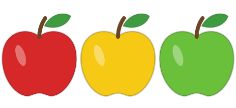
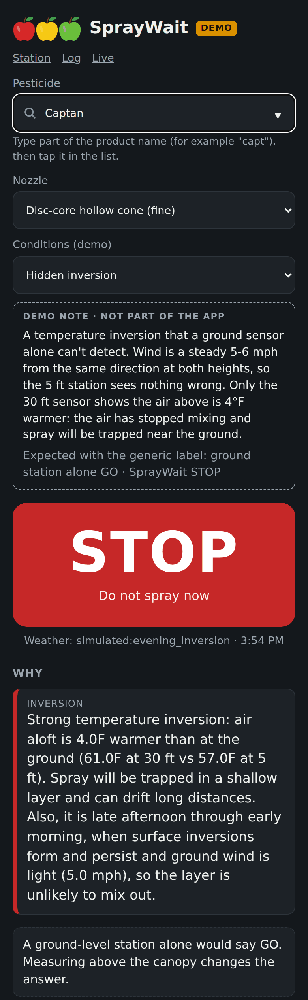
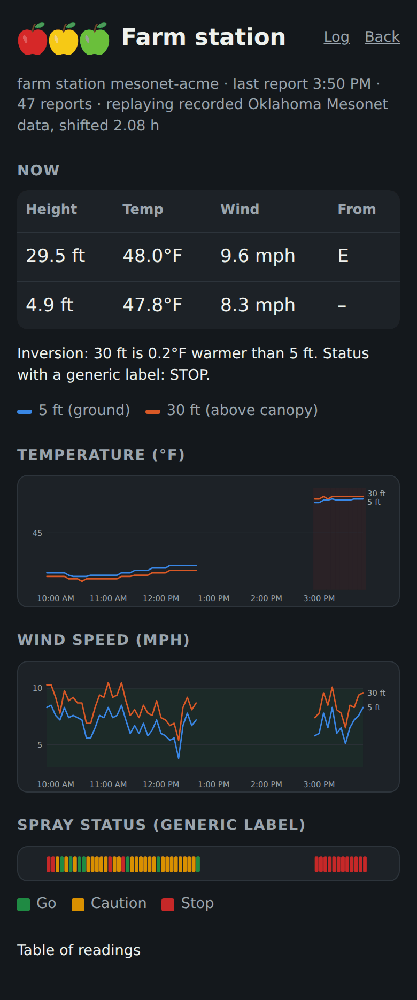
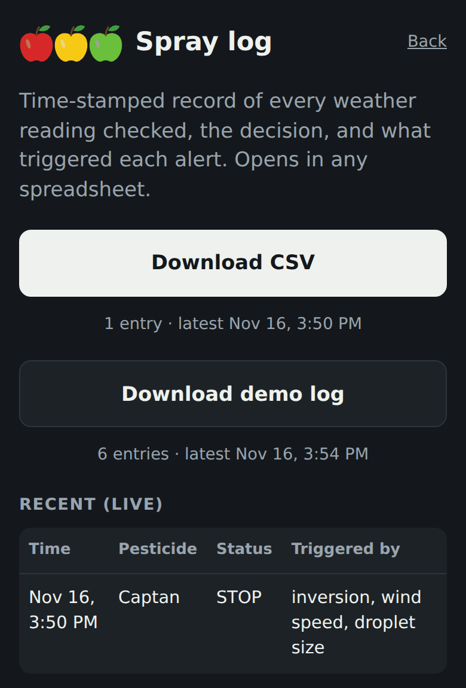

<p align="center"></p>

# SprayWait: A Pesticide Drift Awareness Tool

SprayWait helps orchard applicators decide whether to spray pesticide right now. It reads weather at two heights in the orchard, along with the pesticide and spray nozzle being used, and answers **Go**, **Caution**, or **Stop**. SprayWait doesn't ask to be taken on faith: every answer comes with its science-based reasons, so applicators can make their own informed decisions.

**Live app:** https://spraywait.onrender.com (free hosting; the first load can take up to a minute)

<table>
  <tr>
    <td align="center"></td>
    <td align="center"></td>
    <td align="center"></td>
  </tr>
  <tr>
    <td align="center"><sub>A ground station alone says GO.<br>The 30 ft sensor makes it STOP.</sub></td>
    <td align="center"><sub>Station readings at both heights,<br>and spray status over the day.</sub></td>
    <td align="center"><sub>Time-stamped log of every decision<br>and what triggered it.</sub></td>
  </tr>
</table>

## AgX Arizona Summit Hackathon

SprayWait was built in 6 hours at the [AgX Arizona Summit](https://hack.arizona.edu/hack-arizona-agx-hacking-future-agriculture) hackathon, hosted by [Hack Arizona](https://hack.arizona.edu/) on **November 15, 2026**.

Our team scored **18.5/20** and placed **5th out of 30 teams**.

### Team

- **Zach Keyes:** app UI, station, forecast, log, alerts, Render deployment, demo, and docs. [LinkedIn](https://www.linkedin.com/in/zkey/) · [Website](https://mnestic.space)
- **Joy Hewang:** pesticide data, science research, and app UI features. [LinkedIn](https://www.linkedin.com/in/lunjoyhewang/)
- **Leo Edgin:** inversion and wind-shear models and the core decision engine. [LinkedIn](https://www.linkedin.com/in/leo-edgin-31a50724b/)

## The problem

When pesticides are sprayed in an orchard, some can drift beyond the target area and reach neighboring crops, workers, communities, and the environment. Weather is one of the biggest factors, but applicators usually judge conditions by what they see and feel at ground level, or by regional forecasts that may not match what's happening inside the orchard.

One of the riskiest conditions is hard to spot: a **temperature inversion**. Normally, air gets cooler as you go up. In an inversion, cool air sits near the ground under warmer air. The air stops mixing upward, so fine spray droplets and vapor stay in a shallow layer and can travel sideways for long distances. Calm air at ground level doesn't mean it's safe either: winds above the trees can be stronger or blowing a different way.

The challenge: build a decision-support tool that uses weather readings from more than one height to tell an applicator whether it's safe to spray right now, and why.

## What it does

- **Reads weather at two heights** (about 5 ft and 30 ft) from the orchard's station, plus the pesticide and nozzle being used.
- **Says GO, CAUTION, or STOP right now**, with the reasons in plain language: inversion, wind too low or too high, wind changing with height, heat and volatility limits.
- **Alerts** when conditions get worse (GO → CAUTION/STOP, CAUTION → STOP), on screen and as a phone notification.
- **Plans ahead:** a 24-hour forecast strip shows the next safe spray window, or warns when conditions are expected to turn bad.
- **Keeps a record:** a time-stamped log of every reading, decision, and what triggered it, downloadable as CSV.
- **Shows the station:** a page charting both heights over the day, with the spray status over time.
- **Works on a phone:** installable web app, designed for use in the field.

## Demo

**Live** (`/`): the farm station replays a real day of Oklahoma Mesonet readings (temperature at 1.5 m and 9 m, wind at 2 m and 10 m) in real time. From about 4:15 to 7:30 pm Arizona time it replays a recorded evening inversion: the ground sensor alone says GO, SprayWait says STOP. The **Station** page (`/station`) charts both heights over the day; the **Log** (`/log`) shows each decision and what triggered it.

**Demo** (`/demo`): each scenario isolates one thing the tool checks. A dashed "Demo note" box says what it illustrates and the expected result; it is a presenter's aid, not part of the field app.

| Scenario | Illustrates | Ground station alone | SprayWait |
|---|---|---|---|
| Hidden inversion | Inversion a ground sensor can't see: 4°F warmer at 30 ft, wind fine | GO | **STOP** |
| Inversion forming | Early warning: same temperature at both heights, mixing has stopped | GO | **CAUTION** |
| Strong wind above the canopy | Wind speed changing with height: 4.5 mph below, 12 mph above | GO | **STOP** |
| Wind turning with height | Wind direction changing with height: 120° apart | GO | **STOP** |
| Good spraying conditions | Control case: no false alarms | GO | **GO** |
| Hot afternoon | Pesticide limits: GO for the generic label, STOP for Malathion (90°F) | GO | **GO / STOP** |
| Too windy | Over 10 mph: a single station catches this too | STOP | **STOP** |
| Dead calm | Under 3 mph: a single station catches this too | STOP | **STOP** |

## How it works

```
Farm station (5 ft + 30 ft)  ─┐
Pesticide + nozzle           ─┼─► Checks ─► GO / CAUTION / STOP + reasons ─► Alert, Log
Hourly forecast (24 h)       ─┘            (same checks per hour) ─► Next spray window
```

Five checks run on every reading. The worst warning wins: any STOP means **STOP**, any CAUTION means **CAUTION**, otherwise **GO**. Every reason is shown.

| Check | STOP | CAUTION | Basis |
|---|---|---|---|
| **Data quality** | No data | Reading over 15 min old, or only one height | Fail safe: missing data is never GO |
| **Inversion** (30 ft minus 5 ft) | Warmer aloft. Named weak (<1°F), moderate, strong (≥3°F) | Nearly equal (within 0.5°F) with ground wind under 7 mph: mixing has stopped. Also, 2 pm–9 am with light wind, air aloft only 0.5–1°F cooler | "If you suspect an inversion, don't spray" (UC ANR). ≥3°F = strongest class (NDSU). 7 mph light-wind rule (UC ANR) |
| **Wind speed** (every height) | Below 3 or above 10 mph | Within 1 mph of either limit | Common guidance; the label's limits come first |
| **Wind shear** (speed) | Aloft ≥8 mph stronger than ground | 5–8 mph stronger | Ground wind doesn't show the air the spray rises into |
| **Wind shear** (direction) | ≥90° apart | 45–90° apart | Direction can flip up to 180° inside an inversion (NDSU) |
| **Pesticide** | Above the label's max temperature. Highly volatile at ≥85°F | Highly volatile at 75–85°F. Moderately volatile at ≥85°F. Fine droplets with wind ≥7 mph | Vapor drift rises with heat; droplets ≤200 µm fall only inches per second (NDSU) |

- **Pesticides and nozzles:** 47 pesticides with label temperature limits and volatility. The nozzle sets droplet size; if none is chosen, droplets are assumed fine, the worst case for drift.
- **Time of day** can only add caution, never remove it.
- **Forecast:** the same checks run on each hour of a 24-hour Open-Meteo forecast to find the next GO window and warn before conditions turn bad. Open-Meteo, not the National Weather Service, because the NWS hourly forecast has no temperature aloft and so cannot show an inversion.
- **Risk score (0–100)** ranks how bad it is within each status (GO 0, CAUTION 20–69, STOP 70–100), so it never contradicts the status. It is not a drift probability. It appears in the API response and the log CSV.
- Cutoffs without a published number are stated design choices that lean toward caution; none can turn a STOP into a GO. Every rule and its source is in [docs/LOGIC.md](docs/LOGIC.md).

## Challenge goals

**Must-haves:** all met.

| Goal | How SprayWait meets it |
|---|---|
| Read temperature and wind at two or more heights | 5 ft and 30 ft from the orchard station: a real recorded Mesonet day on Live, simulated scenarios on Demo. |
| Detect an inversion (upper warmer than lower) | STOP whenever 30 ft is warmer than 5 ft, graded weak, moderate, or strong; CAUTION when one may be forming. |
| Flag wind below 3 mph or above 10 mph | STOP outside the pesticide's label limits (3–10 mph by default), CAUTION within 1 mph of either limit. |
| Flag large wind speed or direction differences between heights | CAUTION at 5 mph or 45°, STOP at 8 mph or 90°. |
| Clear status with plain-language reasons | GO, CAUTION, or STOP with every reason listed, using the measured numbers. |
| Time-stamped log of readings and what triggered each alert | Log page lists every reading, status, and trigger; downloadable as CSV. |

**Stretch goals**

| Goal | Status |
|---|---|
| Factor in pesticide properties and application details | Done. 47 pesticides with label temperature limits and volatility; the nozzle sets droplet size. |
| Use forecasts to predict the next safe window or warn before conditions turn bad | Done. 24-hour forecast strip with the next GO window and an early warning. |
| Monitor during and after spraying | Partly. The app rechecks every minute against readings that arrive every 5 minutes, and alerts as soon as conditions get worse, so it works while spraying. Watching volatile products after spraying is not built yet. |
| Alerts by text or push notification | Partly. Phone notification and in-app banner while the app is open. Notifications to a closed app, and text alerts, are not built yet. |
| Physical sensor prototype | Not built. Stations post readings to an authenticated API; the Mesonet replay tool already does this over the network, so a real mast would only replace the data source. |

## Science

### Temperature inversions (primary drift risk)

- Normally, air temperature decreases with altitude. An inversion occurs when warmer air sits above cooler surface air, suppressing vertical mixing.
- This traps fine pesticide droplets and vapor near the ground, allowing them to drift horizontally over long distances, potentially harming workers and communities.
- Inversions are difficult to detect from ground-level conditions alone (Nowatzki, n.d.).

### Other factors affecting spray drift

- **Wind speed:** very low wind speeds can allow droplets to remain suspended, while stronger winds can carry droplets beyond the target area.
- **Wind shear:** wind speed and direction can change with altitude. Winds above the orchard canopy may be stronger or travel in a different direction than winds near the ground.
- **Droplet size:** smaller droplets remain airborne longer and are more easily transported by wind. Nozzle type and spray pressure influence droplet size (Nuyttens et al., 2007).
- **Temperature and humidity:** high temperatures and low humidity accelerate droplet evaporation, causing droplets to shrink and become more susceptible to drift.
- **Pesticide volatility:** some pesticides can vaporize after application, creating additional drift risks even after spraying has stopped (Al Heidary et al., 2014).

### Forecasting the next spray window

- Inversions commonly develop around sunset, strengthen overnight, and break up after sunrise as the ground warms (UC ANR, n.d.).
- SprayWait uses Open-Meteo's hourly 24-hour forecast to compare temperatures and wind at multiple heights, and applies the same drift-risk checks as the live system to find:
  - **Next GO window:** consecutive hours without detected risk conditions.
  - **Early warning:** when conditions are expected to become CAUTION or STOP.

Forecasts provide planning guidance, not confirmation of orchard conditions. Weather models may underestimate nighttime inversions, so live decisions rely on the orchard's 5 ft and 30 ft sensors (Holtslag et al., 2013).

> **SprayWait is a decision-support tool and does not replace pesticide label requirements, regulations, or professional judgment.**

### References

Nowatzki, J. (n.d.). Understanding air temperature inversions relating to pesticide drift. North Dakota State University Extension. https://www.ndsu.edu/agriculture/extension/publications/understanding-air-temperature-inversions-relating-pesticide-drift

Nuyttens, D., Baetens, K., De Schampheleire, M., & Sonck, B. (2007). Effect of nozzle type, size and pressure on spray droplet characteristics. Biosystems Engineering, 97(3), 333–345. https://doi.org/10.1016/j.biosystemseng.2007.03.001

Al Heidary, M., Douzals, J. P., Sinfort, C., & Vallet, A. (2014). Influence of spray characteristics on potential spray drift of field crop sprayers: A literature review. Crop Protection, 63, 120–130. https://doi.org/10.1016/j.cropro.2014.05.006

Holtslag, A. A. M., Svensson, G., Baas, P., et al. (2013). Stable atmospheric boundary layers and diurnal cycles: Challenges for weather and climate models. Bulletin of the American Meteorological Society, 94(11), 1691–1706. https://doi.org/10.1175/BAMS-D-11-00187.1

Open-Meteo. (n.d.). Weather forecast API documentation. https://open-meteo.com/en/docs

UC ANR. (n.d.). Surface inversions cause spray drift. Topics in Subtropics, University of California Agriculture and Natural Resources. https://ucanr.edu/blog/topics-subtropics/article/surface-inversions-cause-spray-drift

## Run it

```bash
python -m venv .venv && .venv/bin/pip install -r requirements.txt
FARM_API_KEY=devkey .venv/bin/uvicorn api.main:app --port 8000
```

Open http://localhost:8000 (live) or http://localhost:8000/demo (scenarios). Run the tests with `.venv/bin/pytest --cov=spraywait --cov=api --cov=tools`. Configuration, the station tools, and the code layout are in [docs/DEVELOPMENT.md](docs/DEVELOPMENT.md).

## Tech stack

Python (FastAPI) rule engine and API, a plain HTML/JS installable web app (PWA), Open-Meteo forecasts, hosted on Render. 185 pytest tests, 99% coverage.

## What's next

- Real station hardware: the station data format is vendor-style, so a real mast only replaces the data source.
- Push notifications to a closed app (Web Push), and text alerts.
- Inversion-strength calibration against measured drift; ML models trained on station history.
- Monitoring during and after spraying for volatile products.

## License

[MIT](LICENSE)
